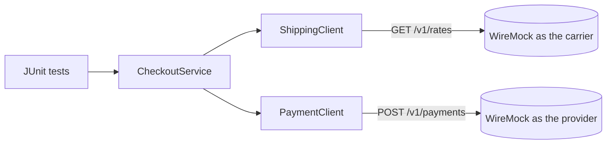
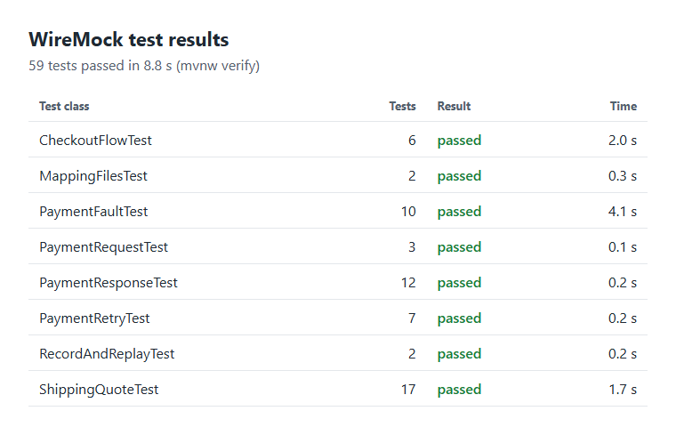

# Testing third-party APIs with WireMock

[](https://github.com/niranjankagri/wiremock-api-mocking/actions/workflows/ci.yml)

How I test code that depends on APIs I don't control. A payment provider's sandbox won't drop a connection halfway
through a response, or answer `429` on the second attempt, when a test needs it to. **WireMock** will, so the failure
paths get the same coverage as the normal one. Java 21, WireMock 3, JUnit 6, AssertJ.

The system under test is a small checkout client, deliberately a few hundred lines. It calls two APIs:



The clients are the real ones, using real HTTP on a local port. Only the base URL differs from production.



## The behaviour under test

| Situation | What the client does | Why |
|---|---|---|
| `503`, `429`, or a broken connection on a payment | Up to 3 attempts, with a doubling wait, or the wait in `Retry-After` (at most 30 s) | Short outages should not cost a sale |
| Any retry | The same `Idempotency-Key` on every attempt | A lost response must not become a double charge |
| Still no clear answer after 3 attempts | Status `PAYMENT_UNKNOWN`, never "failed" | The money may have moved, so nobody may tell the customer it didn't |
| `402` | Status `DECLINED` with the provider's reason, no retry | The answer is clear |
| `400`, `401`, `403`, `404`, `409`, `422` | `PaymentRejectedException`, no retry | Trying again cannot help |
| `201` with an unusable body | `PAYMENT_UNKNOWN` | A success code alone is no proof of payment |
| Carrier down, slow, or giving a bad price | Flat rate, marked as estimated, one attempt | A shipping price isn't worth losing a sale |

## What is tested

| Test class | WireMock feature | Tests |
|---|---|---:|
| `PaymentRequestTest` | Request matching on headers, exact JSON body, request verification | 3 |
| `PaymentResponseTest` | Response templating; each answer the provider can give | 12 |
| `PaymentRetryTest` | Stateful scenarios: a different answer on each attempt | 7 |
| `PaymentFaultTest` | Fault injection (all 4 WireMock faults) and fixed delays | 10 |
| `ShippingQuoteTest` | Query parameter matching, faults, delays, invalid bodies | 17 |
| `CheckoutFlowTest` | Two mock servers together; idempotent repeat of a checkout | 6 |
| `MappingFilesTest` | Stubs as JSON files, `__files` response bodies, stub priority | 2 |
| `RecordAndReplayTest` | Recording through a proxy, then replaying without the provider | 2 |

**59 tests** from 35 test methods. The method names start with their case ID, for example
`tc122_everyAttemptCarriesTheSameIdempotencyKey`, and each case is written out in
[docs/manual-test-cases.md](docs/manual-test-cases.md).

Retry waits are recorded, not slept through, so the whole suite runs in about 10 seconds and the waits themselves are
asserted. Only the timeout tests really wait.

## Run it

```
./mvnw verify        (Windows: mvnw.cmd verify)
```

Java 21 or newer is all it needs: no Docker, no accounts, no network beyond Maven's downloads.

## Design

| Pattern | Where | Why |
|---|---|---|
| Stub object (the page object of API mocking) | `stubs/PaymentProviderStub`, `stubs/ShippingCarrierStub` | Paths, headers and WireMock calls live in one place; tests read as behaviour: `provider.unavailableThenCaptures(2)` |
| Test data builder | `support/CheckoutRequests` | A test states only the value it is about |
| Factory | `support/TestClients`, `support/MockServers` | The real clients pointed at WireMock; every server with the same strict settings |
| Base class | `MockedApisTest` | One life cycle for the servers and clients |
| Strategy | `Sleeper`, `support/RecordingSleeper` | Retry timing can be asserted without waiting |
| Facade | `CheckoutService` | The one entry point the shop calls |

**A strict default.** The stubs only match well-formed requests, and the servers run with `failOnUnmatchedRequests`.
If the client loses a header or calls the wrong path, the test fails even when its own assertions would pass.

More in [docs/framework-design.md](docs/framework-design.md).

## Documents

- [Framework design](docs/framework-design.md): the decisions behind the client and the tests
- [Manual test cases](docs/manual-test-cases.md): every case in plain language, by ID
- [Interview questions](docs/interview-questions.md) ([PDF](docs/interview-questions.pdf)): 60 questions on API mocking,
  answered with this project

## What this does not prove

A mock only knows what I told it, so these tests can't notice the real provider changing its API. Contract tests
cover that gap: see [pact-contract-testing](https://github.com/niranjankagri/pact-contract-testing). The provider
here is also invented, so its API is modelled on common payment APIs, not on one vendor's documentation.

## License

[MIT](LICENSE)
